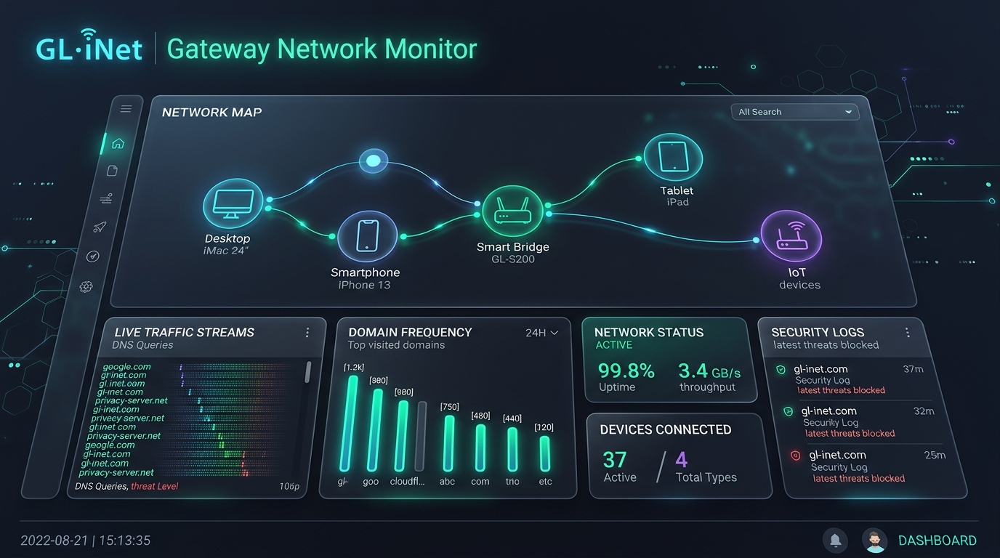
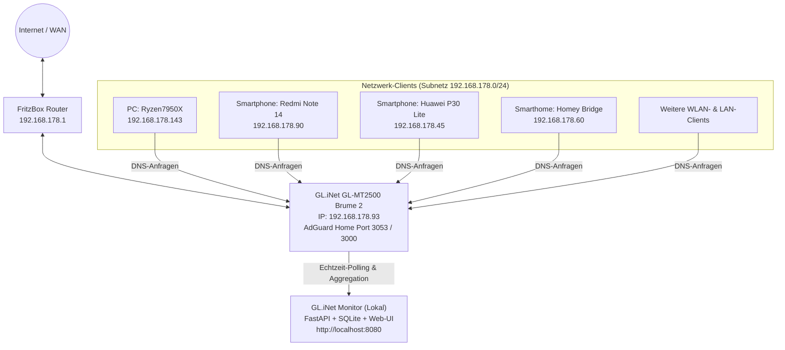
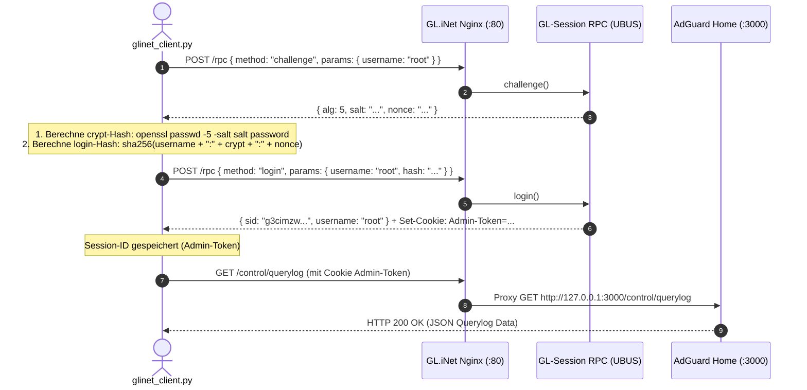
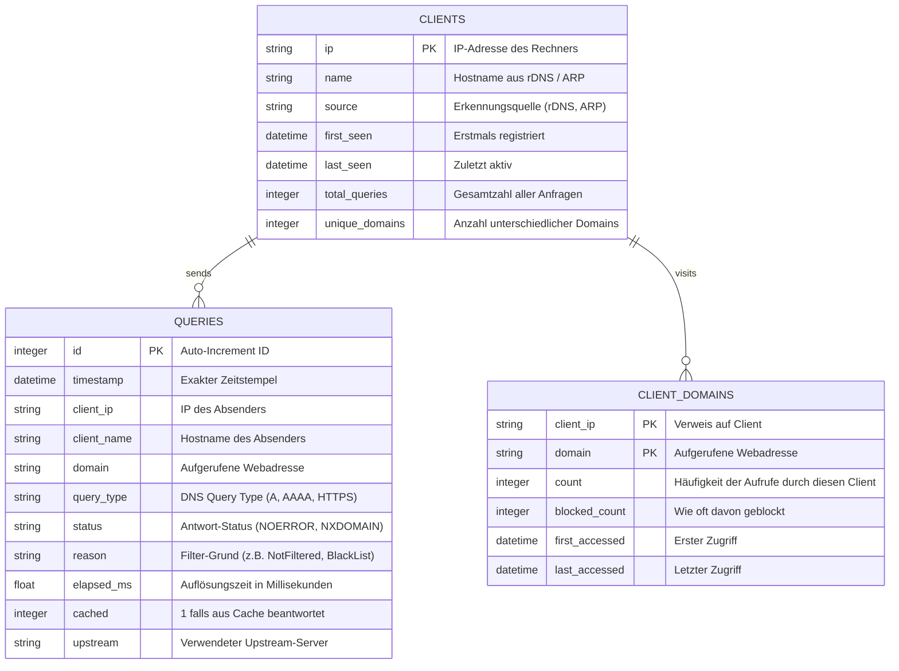

# GL.iNet Gateway Network Monitor — Vollständige Systemdokumentation 📘



## 1. Systemübersicht & Zielsetzung

Der **GL.iNet Gateway Network Monitor** ist eine spezialisierte Monitoring- und Analyse-Lösung für das lokale Netzwerk. Er analysiert kontinuierlich den gesamten DNS- und Webverkehr, der über das **GL.iNet Sicherheits-Gateway (GL-MT2500 / Brume 2)** läuft.

### Kernfunktionalität
- **Client-Identifikation:** Automatische Erkennung aller aktiven Rechner, Smartphones, Smarthome-Bridges und IoT-Geräte im LAN/WLAN inklusive IP-Adresse, rDNS-Hostnamen (`Ryzen7950X`, `Redmi-Note-14`, `homey`, etc.) und Gerätetyp.
- **Webadressen & Häufigkeit pro Rechner:** Für jedes einzelne Gerät wird exakt aufgelistet, welche Internetadressen (Domains) aufgerufen wurden, wie oft dies geschah (Aufrufzähler), wie viel Prozent des Client-Verkehrs dies ausmacht und wann der letzte Zugriff stattfand.
- **Netzwerkweite Statistiken:** Ermittlung der am häufigsten aufgerufenen Adressen im gesamten Netzwerk inklusive Querverweis, welche und wie viele Rechner diese Domain aufgerufen haben.
- **Live-Stream & Analyse:** Echtzeit-Ticker aller DNS-Abfragen inklusive Query-Typ (A, AAAA, HTTPS), Antwort-Status, Latenz und Filterlisten-Einstufung (Erlaubt / Blockiert).
- **Historisierung:** Alle Daten werden persistent in einer lokalen SQLite-Datenbank protokolliert und aggregiert, wodurch Verläufe über Tage, Wochen und Monate ohne Datenverlust erhalten bleiben.

---

## 2. Netzwerk-Topologie & Hardware



### Technische Spezifikation des Gateways
- **Modell:** GL.iNet GL-MT2500 (Brume 2)
- **Prozessor & OS:** MediaTek MT7981B (Cortex-A53 Dual-Core @ 1.3GHz), Linux 5.4.211 aarch64
- **Firmware-Version:** GL.iNet v4.7.13 (OpenWrt-Basis)
- **Netzwerk-Schnittstellen:** 2.5G WAN (Port verbunden mit 192.168.178.93), 1G LAN (192.168.8.1)
- **DNS-Engine:** AdGuard Home v0.107.52 (integriert, lauscht auf Port 3053)
- **Webserver & Reverse Proxy:** Nginx mit Lua-Modulen (`/usr/share/gl-ngx/`)

---

## 3. Authentifizierungs- & Sicherheitsarchitektur

Das GL.iNet Gateway verwendet für seine Web-Verwaltung ein herstellerspezifisches Challenge-Response-Verfahren über UBUS/RPC. Direkte unauthentifizierte Zugriffe auf AdGuard Home (`/control/*`) werden durch den Nginx-Proxy mit `HTTP 403 Forbidden` abgewiesen (`glinetMode`).



### Hash-Algorithmus im Detail
1. **Challenge:** Gibt den kryptografischen Algorithmus (`alg=5` = SHA-256 crypt), das zufällige `salt` und die `nonce` der Sitzung zurück.
2. **Password Crypt:** Mittels `openssl passwd -5 -salt "$salt" "$password"` wird der UNIX-kompatible Passwortersatz gebildet.
3. **Session Hash:** Aus `username:pw_crypt:nonce` wird die finale SHA-256-Prüfsumme errechnet.
4. **Token-Verwaltung:** Das vom Gateway ausgestellte `sid` wird bei allen weiteren API-Aufrufen im HTTP-Cookie `Admin-Token` mitgesendet. Verfällt die Sitzung, führt `glinet_client.py` transparent einen Re-Login durch.

---

## 4. Software-Architektur & Komponenten

Die Anwendung ist in Python mit asynchroner FastAPI-Architektur und einer lokalen SQLite-Datenbank aufgebaut:

```
GliNetMonitor/
├── config.json              # Router-IP, Zugangsdaten, Polling-Parameter, Web-Port
├── glinet_client.py         # Hardware-Schnittstelle & Authentifizierung zu GL.iNet
├── database.py              # SQLite-Speicher, Tabellenschema & Aggregationsabfragen
├── collector.py             # Asynchroner Background-Worker für Abruf & Deduplizierung
├── main.py                  # FastAPI REST-API & statischer Webserver
├── start.bat                # Windows 1-Klick-Startskript
├── README.md                # Kurzanleitung
├── DOKUMENTATION.md         # Ausführliche Systemdokumentation
├── glinet_monitor.db        # SQLite-Datenbank (automatisch generiert)
└── static/
    ├── index.html           # Single-Page-Application Dashboard
    ├── style.css            # Dark-Mode Glassmorphism Design
    └── app.js               # Frontend-Logik, Tab-Handling & Chart.js Visualisierung
```

---

## 5. Datenmodell (SQLite-Schema)



### Leistungsmerkmale der Datenbank
- **Deduplizierung:** Ein zusammengesetzter Unique-Index über `(timestamp, client_ip, domain, query_type)` verhindert doppelte Einträge beim wiederholten Abruf aus dem Router-Puffer.
- **Echtzeit-Aggregation:** Die Zwischentabelle `client_domains` wird bei jedem Query-Insert atomar gepflegt. Dadurch laufen Domain-Häufigkeitsabfragen pro Rechner in unter 2 Millisekunden, selbst bei Millionen von Einzelanfragen.

---

## 6. REST-API Spezifikation

| Endpunkt | Methode | Beschreibung | Parameter |
| :--- | :---: | :--- | :--- |
| `/api/status` | `GET` | Status der Gateway-Verbindung und des Collectors | Keine |
| `/api/summary` | `GET` | Globale KPIs (Gesamtanfragen, Clients, Domains, Geblockt, Latenz) | Keine |
| `/api/clients` | `GET` | Liste aller Rechner im Netzwerk mit Anfragezahlen | `search` (optional) |
| `/api/clients/{ip}/domains` | `GET` | Alle Domains eines bestimmten Rechners mit Häufigkeit & Anteil | `search`, `status` (all/allowed/blocked), `sort`, `limit`, `offset` |
| `/api/domains` | `GET` | Top-Domains netzwerkweit mit Client-Anzahl | `limit`, `search` |
| `/api/activity` | `GET` | Live-Feed der jüngsten DNS-Anfragen | `client_ip` (optional), `limit` |
| `/api/trends` | `GET` | Anfragenvolumen und aktive Rechner pro Stunde | `hours` (Standard 24) |
| `/api/sync` | `POST` | Manuelle Sofort-Synchronisation mit dem Gateway | Keine |

---

## 7. Bedienung des Web-Dashboards

Das Dashboard ist unter **`http://localhost:8080`** erreichbar und gliedert sich in folgende Bereiche:

### 1. Geräte & Webadressen (Hauptansicht)
- **Linke Spalte (Geräteliste):**
  - Zeigt alle Rechner im Netzwerk mit passendem Icon (Desktop, Smartphone, IoT-Modul, Smart-TV).
  - Listet IP-Adresse, Hostname und die Gesamtzahl der Anfragen sowie unterschiedlicher Domains.
  - Suchfeld zum schnellen Filtern nach IP oder Gerätename.
- **Rechte Spalte (Domain-Details des gewählten Rechners):**
  - **Banner:** Zeigt den gewählten Rechner, IP, Gesamtaufrufe und Domain-Anzahl.
  - **Mini-Balkendiagramm:** Visualisiert die 5 am häufigsten aufgerufenen Adressen dieses konkreten Geräts.
  - **Filterleiste:** Umschaltung zwischen *Alle*, *Nur Erlaubt* und *Nur Blockiert* sowie Sortieroptionen (*Häufigkeit*, *Zuletzt aufgerufen*, *Alphabetisch*).
  - **Tabelle:** Vollständige Auflistung jeder Webadresse mit optischem Prozentbalken, Anzahl der Aufrufe, Zeitstempel und Statusbadge.

### 2. Netzwerk Top-Domains
- Tabellarische Auswertung der meistaufgerufenen Adressen netzwerkweit.
- Zeigt zusätzlich an, von **wie vielen unterschiedlichen Rechnern** eine Adresse angefordert wurde.

### 3. Live-Stream
- Kontinuierlicher Ticker der einlaufenden DNS-Abfragen im Sekundentakt.
- Enthält Zeitstempel, Quellgerät, aufgerufene Domain, DNS-Typ (z. B. A oder AAAA), Bearbeitungszeit und Filterentscheidung.
- Über die Schaltfläche **Pausieren** kann der Stream für Inspektionen angehalten werden.

### 4. Aktivitätsverlauf
- Interaktives Verlaufsdiagramm der letzten 24 Stunden mit Doppelachse (Anfragenvolumen auf der linken Achse, Anzahl aktiver Rechner auf der rechten Achse).

---

## 8. Konfiguration (`config.json`)

```json
{
  "router": {
    "ip": "192.168.178.93",
    "username": "root",
    "password": "YOUR_PASSWORD",
    "timeout": 10
  },
  "collector": {
    "poll_interval_seconds": 5,
    "backfill_limit": 1000
  },
  "server": {
    "host": "0.0.0.0",
    "port": 8080
  },
  "database": {
    "path": "glinet_monitor.db"
  }
}
```

- **`poll_interval_seconds`:** Zeitspanne zwischen Hintergrund-Abfragen des Gateways (Standard: 5 Sekunden).
- **`backfill_limit`:** Maximale Anzahl historischer Abfragen, die beim Serverstart rückwirkend aus dem Router-Puffer in die SQLite-Datenbank eingelesen werden (Standard: 1000).
- **`port`:** Port des lokalen Web-Dashboards (Standard: 8080).

---

## 9. Wartung & Troubleshooting

### Häufige Fehlerszenarien
1. **"Gateway Offline / Fehler" im Status-Badge:**
   - Prüfen, ob das Gateway unter `192.168.178.93` per Ping erreichbar ist.
   - Prüfen, ob das Kennwort in `config.json` mit dem Root-Kennwort des Gateways übereinstimmt.
2. **Keine Daten bei einem bestimmten Gerät:**
   - Sicherstellen, dass das Endgerät den DNS-Server `192.168.178.93` nutzt (entweder manuell eingetragen oder via FritzBox DHCP als lokaler DNS-Server verteilt).
3. **Datenbank sichern oder bereinigen:**
   - Die gesamte Historie liegt in der Einzeldatei `glinet_monitor.db`. Eine Sicherung erfolgt einfach durch Kopieren der Datei.
